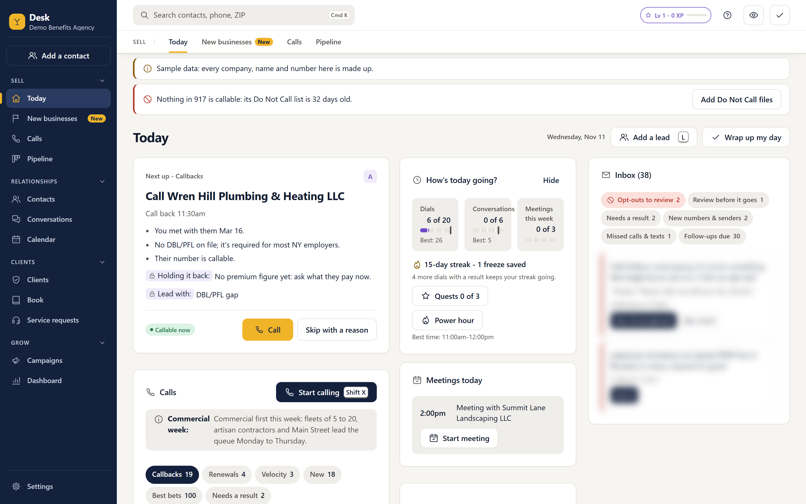
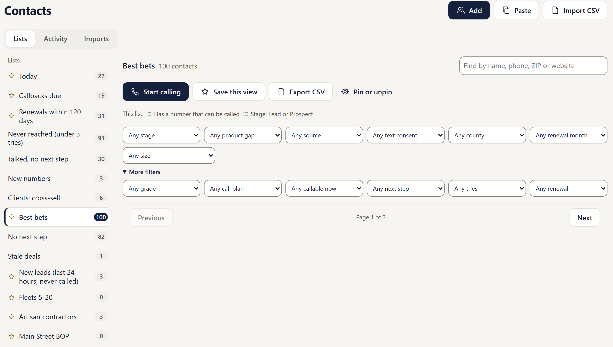
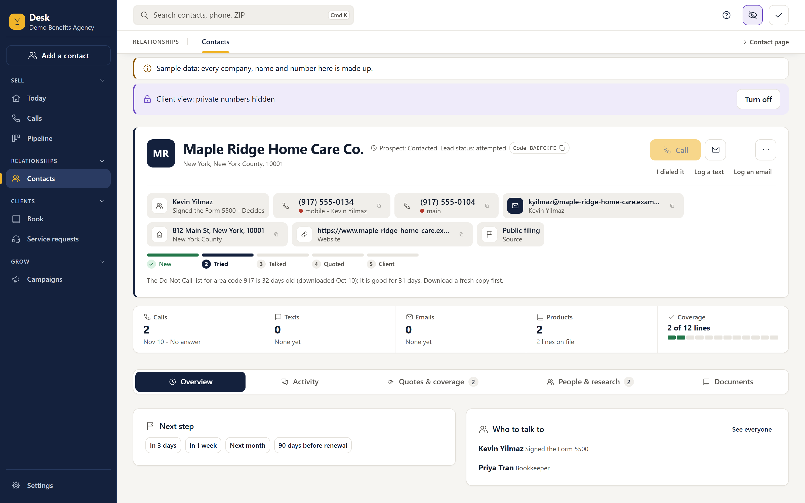
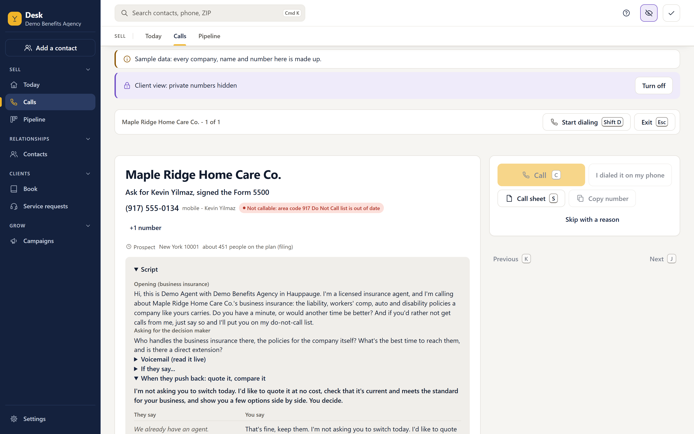
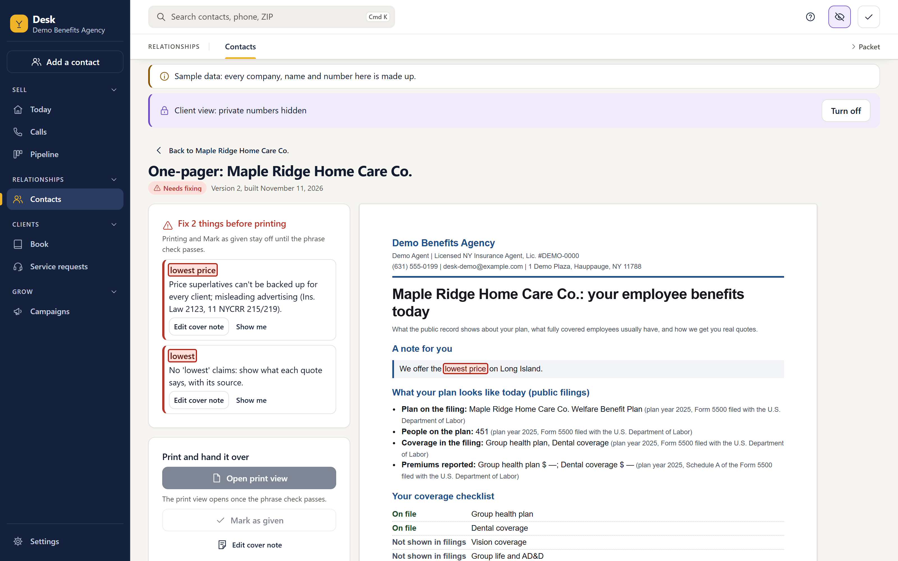
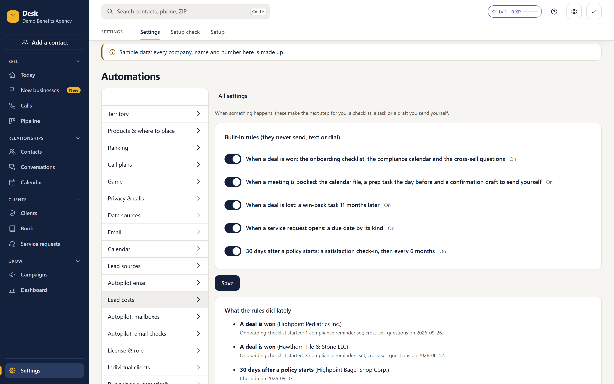



# Yanza Desk

**A local-first sales, CRM and compliance workstation for independent insurance agents, built by a licensed agent who runs his own agency on it.**

Public records in. Ranked, rule-checked outreach out. Every call, letter and email passes the rules before it goes.

By [Anthony Yanza Tomala](https://www.linkedin.com/in/anthonyyanza), Licensed NY Insurance Producer, License #1986535, founder of [Yanza Brokerage Group](https://yanzabrokeragegroup.com) (Patchogue, NY). Winner, **Best Cross-Platform Integration Prize, UiPath AgentHack 2026** (333+ submissions, 104 countries).

> **Stage, stated plainly:** one agency, one user, pre-revenue. The agency opened in October 2026. Everything below describes what is built, not sales results.

---

## What it does

| | |
|---|---|
| **Lead engine** | Reads 15 public-record sources (federal Form 5500 benefit filings, NY corporation filings, FMCSA trucking, OSHA, SBA, liquor licenses, NYC permits and licenses, DOL public work, DEC, WARN) and matches them onto one record per company: 230K+ records so far |
| **Company profiles** | Decision maker, phones, email, address, website and company size (employees, vehicles, payroll, revenue), each fact labeled actual, projected or estimate |
| **Ranking** | Who to call today and a dated reason why |
| **CRM and agency management** | 16 saved lists and 9 filters, conversations, calendar, pipeline, clients, renewals, commissions, service requests and a compliance calendar |
| **Sales game** | Daily goals, streaks, quests and a power hour |
| **Campaigns and automated email** | Mail-merge builder and an email autopilot that re-checks every rule right before each send. Off until the agent turns it on |
| **Calling help** | One company at a time, a script, one-key results. Never dials by itself |
| **Lead connector** | Website quote requests, lead services and referrals flow straight in |
| **AI assistant** | Claude skills that read the day, log a call after approval and explain problems |
| **Compliance in code** | A five-step calling check, a wording checker with no override, and Client view that hides private numbers, enforced on the server |

## Screens (sample data only)

Every image below shows a fictional sample dataset. No real person, business or client appears.

**Today: one next step and the reasons why**

**Contacts: 16 saved lists and 9 filters**

**A company profile, in Client view (private numbers hidden)**

**The calling check refuses a number whose Do Not Call list is out of date**

**The wording checker blocks a price superlative, with no override**

**Automations that make the next step and never send on their own**

## The rules run before every call

1. Opted out, or on the do-not-contact list?
2. Valid number?
3. Do Not Call list loaded and fresh?
4. Inside calling hours where they are?
5. Fewer than 3 tries in 24 hours?

The first failure decides, and the Desk says why in plain words. 17 static tests read the code itself and fail if anyone, including the AI, adds auto-dialing, recorded or AI voice, text sending or rewriting of the opt-out register.

## By the numbers

- About **296,000** lines of code and tests
- More than **3,600** automated tests
- **0** required Python packages (standard library only), SQLite, plain JavaScript, no framework or build step
- **230K+** public records from **15** sources
- A **78-page** English and Spanish website that feeds the Desk

## How it's built

I designed every rule and reviewed every change; Claude wrote much of the code, working in Claude Code. The Desk runs on the agent's own computer (`127.0.0.1`), so there is no cloud database for client records. Keys live in the operating system's secure store, and a guard hook keeps the coding assistant away from keys and client data. It is built on national public datasets that cover every state and is set up for New York today. Each agent can run their own copy with their own leads and CRM.

## What is public and what is private

This repository is a **showcase**. It is on purpose not the product's source code.

| | Public here | Private |
|---|---|---|
| What it does, screens, architecture, numbers | Yes | |
| Sample-data demo videos | Yes (see below) | |
| **Source code** | | Private repository |
| **Real data**: prospects, leads, clients, calls, the opt-out register | | Private, on the agent's own computer only |
| **Keys, credentials, mailbox and phone-app settings** | | Private |
| **Insurer relationships, commission and pricing details** | | Private |
| **Real-data demo videos** | | Shared with judges and partners only, by direct file or password link |

Why: the Desk is built around client privacy (23 NYCRR 500 and the telemarketing rules for licensed producers). Publishing real data or the guard and key handling would defeat that. Reviewers who need to see more can ask for a private walkthrough.

## Demo videos

- Public, sample data: _link to be added_
- Real-data walkthrough for judges and partners: on request, by file or password link

## Contact

Anthony Yanza Tomala · (631) 823-7630 · contact@yanzabrokeragegroup.com · [yanzabrokeragegroup.com](https://yanzabrokeragegroup.com) · [LinkedIn](https://www.linkedin.com/in/anthonyyanza)

© 2026 Yanza Brokerage Group. All rights reserved. This repository contains documentation and sample-data screenshots only; no source code is licensed or included.
